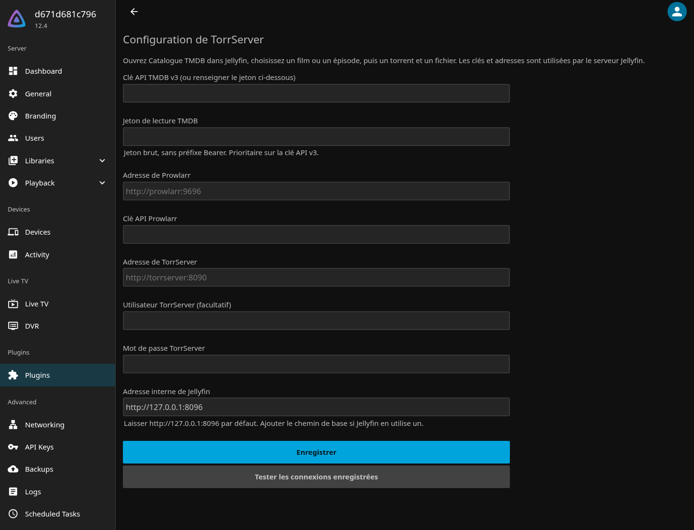
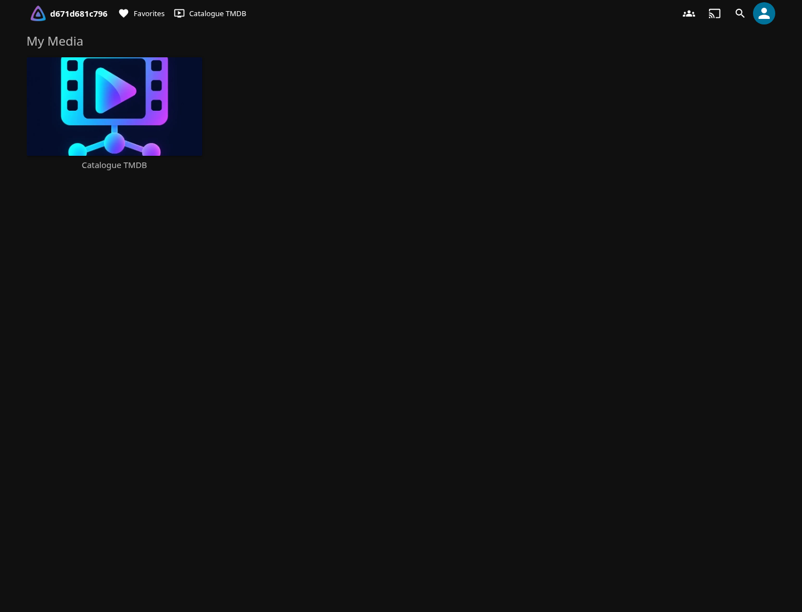
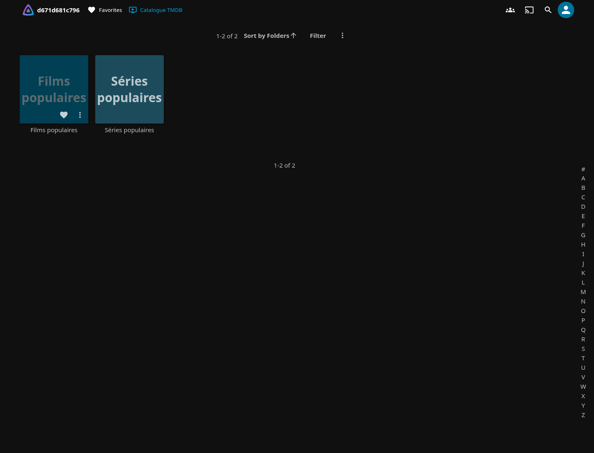
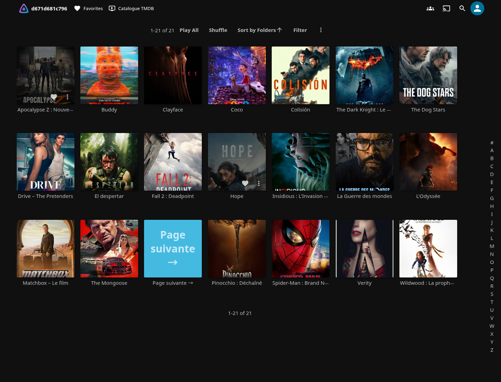
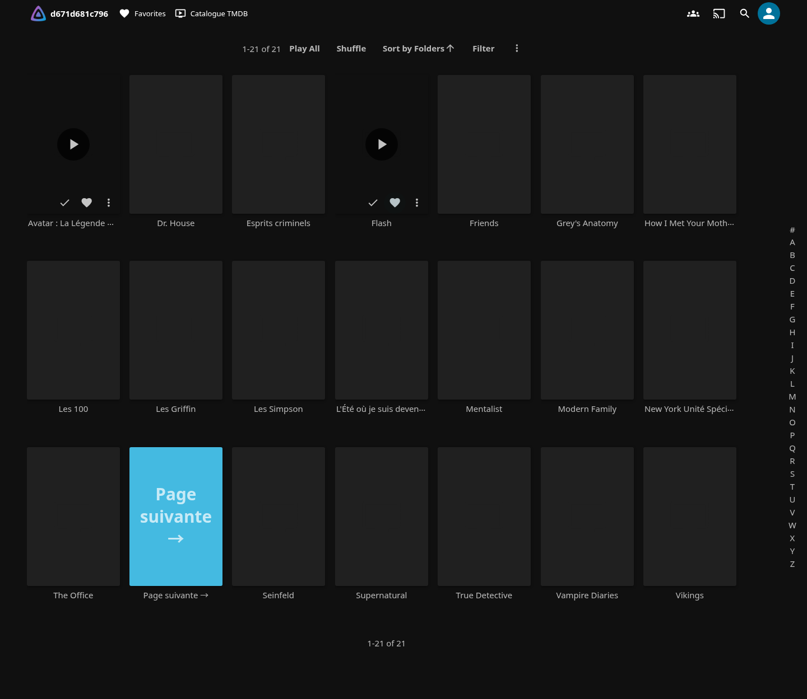

# Jellyfin TorrServer


Plugin serveur Jellyfin : parcourir les affiches TMDB sans télécharger les films, choisir un torrent dans Prowlarr, choisir un fichier dans ce torrent, puis le lire via TorrServer. Aucun changement du code source de Jellyfin.

## Ce fork

Ce fork de [jonathan-pp/jellyfin-torrserver](https://github.com/jonathan-pp/jellyfin-torrserver) sert une instance Prowlarr qui contient aussi des trackers privés. TorrServer ne seede pas le fichier complet : il ne doit pas recevoir leurs torrents.

- **Indexeurs publics seulement.** Le plugin lit les indexeurs de Prowlarr et ne cherche que sur ceux qui sont actifs, publics et en torrent. S'il n'y en a aucun, la recherche est refusée : sans liste, Prowlarr interroge tous ses indexeurs.
- **Liens magnet.** Pour les indexeurs sans fichier `.torrent`, comme 1337x, Prowlarr répond par une redirection vers un lien `magnet:`. Le plugin l'accepte désormais.
- **Paquets.** Chaque version est compilée depuis ce code par la CI du dépôt, pour Jellyfin 12.4 uniquement.

Dépôt d'extensions à ajouter dans Jellyfin :

```
https://github.com/sos-pc/jellyfin-torrserver/releases/latest/download/manifest.json
```

Le reste de ce document vient du projet d'origine.

## Captures réelles de l’interface

Captures réelles prises dans Jellyfin **12.4**, avec le plugin **0.1.1.2**. La clé TMDB a été vérifiée : les listes ci-dessous contiennent de vraies affiches. Le nom du serveur visible est un identifiant de conteneur de test, pas celui d’un serveur personnel. Les clés ne sont pas montrées.

### Configuration du plugin



### Accueil de Jellyfin et logo du plugin



### Entrée du catalogue



### Films : affiches réelles



### Séries : affiches réelles



### Simulation des options de lecture

Cette illustration générée montre le choix d’une source et d’un fichier avec des données fictives. Ce dialogue n’est pas un écran implémenté : le plugin actuel utilise les dossiers et les écrans natifs de Jellyfin. Aucune recherche Prowlarr ni lecture TorrServer réelle n’a été lancée pour cette image.


## Installation

Dans **Tableau de bord → Extensions → Dépôts**, ajouter ce dépôt :

```
https://github.com/sos-pc/jellyfin-torrserver/releases/latest/download/manifest.json
```

Ouvrir le catalogue des extensions, installer **TorrServer**, redémarrer Jellyfin, puis ouvrir sa page de configuration. Le JSON référence l'archive de la dernière version et son checksum MD5 exigé par Jellyfin ; une empreinte SHA-256 est aussi publiée avec chaque version.

Version ciblée : **Jellyfin 12.4** (.NET 10). Les autres versions n'ont pas été validées.

## Configuration après installation

- Clé API **TMDB v3** ou **jeton de lecture TMDB**. Saisir le jeton brut dans son champ dédié (sans préfixe `Bearer`) ; il est prioritaire sur la clé v3. Si le champ est vide, les variables serveur `TMBD_API_LECTURE` puis `TMDB_API_LECTURE` sont également prises en charge.
- Adresse de **Prowlarr** et sa clé API ; les indexeurs de torrents doivent être configurés et accessibles dans Prowlarr.
- Adresse de **TorrServer**, avec utilisateur/mot de passe facultatifs si son authentification est activée.
- Adresse interne de Jellyfin : conserver `http://127.0.0.1:8096` sauf port personnalisé, HTTPS uniquement ou chemin de base. Le serveur Jellyfin et FFmpeg doivent pouvoir atteindre cette adresse.

Enregistrer, puis cliquer sur **Tester les connexions enregistrées**. Les adresses sont vues depuis le serveur Jellyfin : dans Docker, `localhost` pour Prowlarr/TorrServer désigne le conteneur Jellyfin ; utiliser les noms des services ou leurs adresses réseau.

## Utilisation

Ouvrir **Catalogue TMDB** parmi les chaînes de Jellyfin. L'interface utilise les écrans natifs de Jellyfin, pas les maquettes dessinées durant la conception. Ce n'est pas une bibliothèque de fichiers locale.

- Film : ouvrir le film, choisir un torrent, puis ouvrir le fichier vidéo et lancer la lecture.
- Série : choisir une saison et un épisode, puis une recherche d'épisode, de pack de saison ou de série. Choisir un torrent, puis le fichier voulu.
- Tous les fichiers vidéo du pack restent visibles : le choix manuel fonctionne même si les noms ne permettent pas de reconnaître les épisodes. Les correspondances `S02E03` ou `2x03` sont signalées lors d'une recherche d'épisode.
- Chaque résultat affiche le titre brut, l'indexeur, la taille et le nombre de sources annoncé par Prowlarr. La langue et la qualité restent celles indiquées dans ce titre ; aucune correspondance automatique n'est garantie.
- Les pages suivantes du catalogue sont des dossiers « Page suivante ». Les recherches et listes sont mises en cache environ cinq minutes. Le catalogue commence par les titres populaires ; il ne comporte pas encore de saisie libre de recherche TMDB dans les clients Jellyfin.

La simple consultation des affiches ne contacte pas TorrServer. Ouvrir un torrent récupère ses métadonnées ; la lecture démarre le transfert du fichier choisi. TorrServer télécharge et met des morceaux en cache pendant la lecture : il ne faut pas attendre le téléchargement complet, mais une source sans pairs ou trop lente peut échouer. Les torrents ajoutés sont conservés dans TorrServer ; leur suppression et la gestion du cache se font dans TorrServer.

Les choix sont conservés dans le dossier de données du plugin et survivent aux redémarrages. Le relais de lecture prend en charge les requêtes HTTP Range et évite de transmettre les identifiants TorrServer aux clients. Les liens de lecture sont temporaires et cessent de fonctionner après un redémarrage de Jellyfin ; relancer la lecture dans ce cas. Les URL de trackers et les clés restent des données sensibles : protéger les dossiers de configuration et de données de Jellyfin.

Le catalogue est classé R et respecte les restrictions d'accès aux chaînes de Jellyfin. Le champ XML avancé `AllowedUserIds` permet de limiter le catalogue à des identifiants utilisateurs (tableau vide : tous les utilisateurs autorisés par Jellyfin).

## Développement et validation

Installer les SDK .NET 8, 9 et 10, puis :

```sh
dotnet test tests/TorrServer.Tests.csproj -c Release
python3 scripts/package.py 0.0.0.0
```

Pour publier une version, pousser un tag `v<version>` (par exemple `v0.1.2.0`) : la CI lance les tests, compile le paquet et crée la version GitHub avec son manifeste.

Les tests utilisent des réponses contrôlées pour TMDB, Prowlarr et TorrServer : parcours de sélection d'un pack et d'un fichier, persistance, correspondance d'épisodes, upload `.torrent`, authentification, annulation, jetons de lecture et relais Range. Ces tests ne prouvent pas la disponibilité des indexeurs ou des pairs réels.

`tests/jellyfin_smoke.py` vérifie un serveur Jellyfin **de test isolé** sur `127.0.0.1:18196` (ou `JELLYFIN_SMOKE_URL`) : initialisation du serveur, chargement du plugin, configuration et dossiers natifs du catalogue. Ne pas l'utiliser sur une installation personnelle existante. Les clés personnelles et une lecture avec vos indexeurs réels ne sont pas incluses dans les tests.

Pour tester l'installation depuis le JSON public sur un serveur de test vierge : exécuter `tests/jellyfin_smoke.py` avec `JELLYFIN_SMOKE_INSTALL=1`, redémarrer ce serveur, puis relancer le script sans cette variable. Le test remplace la liste des dépôts du serveur de test. `JELLYFIN_SMOKE_VERSION` permet de vérifier une version précise.

Validation effectuée : 14 tests automatisés par cible (.NET 8, 9 et 10), chargement du plugin et de sa configuration dans Jellyfin 10.10.7, 10.11.11 et 12.4.0, installation depuis le dépôt JSON public dans 10.11.11 et 12.4.0, puis vérification après redémarrage. La lecture avec des indexeurs et des pairs réels reste à vérifier avec votre configuration.
